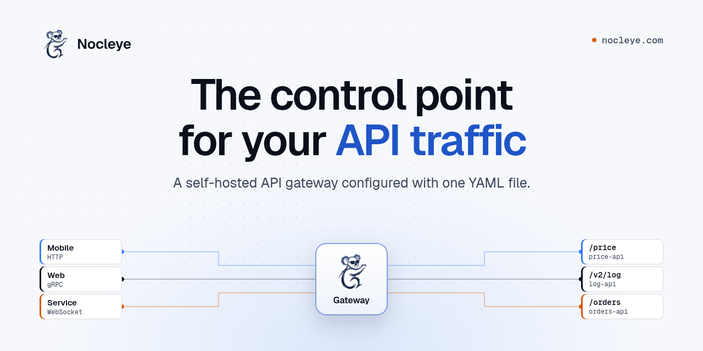

  <picture>
    <source media="(prefers-color-scheme: dark)" srcset="assets/nocleye-hero-github-dark.png">
    <source media="(prefers-color-scheme: light)" srcset="assets/nocleye-hero-github-light.png">
    
  </picture>

  <a href="https://nocleye.com">Website</a> ·
  <a href="https://nocleye.com/docs">Docs</a> ·
  <a href="https://nocleye.com/docs/releases/">Releases</a> ·
  <a href="https://hub.docker.com/r/nocleye/api-gateway">Docker Hub</a>

---

Hi, we are **Nocleye**: the control point for your API traffic.

We build tools for teams that run their own APIs and want a single, clear place to decide what gets in, who is calling, and how much they can call.

## How we work

- **Simple to use.** Our focus is to make the easiest API gateway to use. One file describes everything.
- **Mistakes caught before you ship.** One command tells you whether your config is correct before anything runs.
- **Self-hosted.** It runs on your own infrastructure, in front of your own services.
- **Clear priorities.** We deliver in this order: **Security → Ergonomics → New features → Performance.**

## What we make

The **Nocleye API Gateway** is a self-hosted entry point for your backend services, configured with one YAML file. It is in beta today, and we are working toward a stable release.

Learn more in the [api-gateway repository](https://github.com/nocleye/api-gateway) and the [documentation](https://nocleye.com/docs/).

## Get in touch

- Bugs, feature requests and questions: [open an issue](https://github.com/nocleye/api-gateway/issues/new/choose)
- Security issues: please email [contact@nocleye.com](mailto:contact@nocleye.com) instead of opening a public issue
- Anything else, or just to say hi: [contact@nocleye.com](mailto:contact@nocleye.com)
